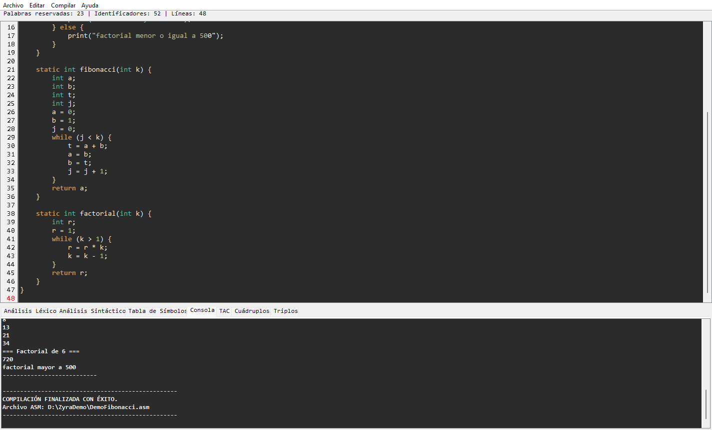
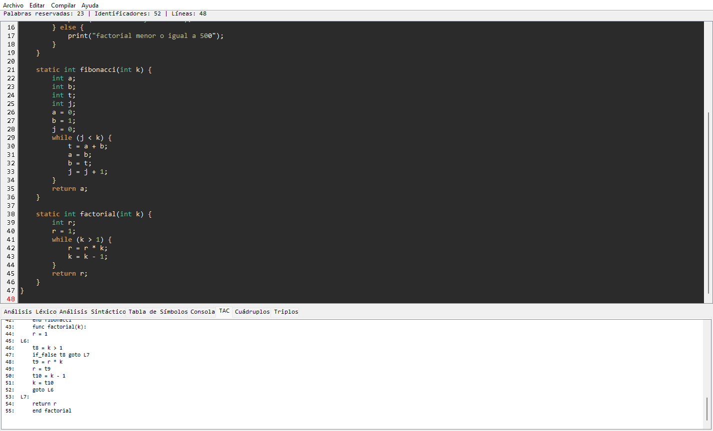
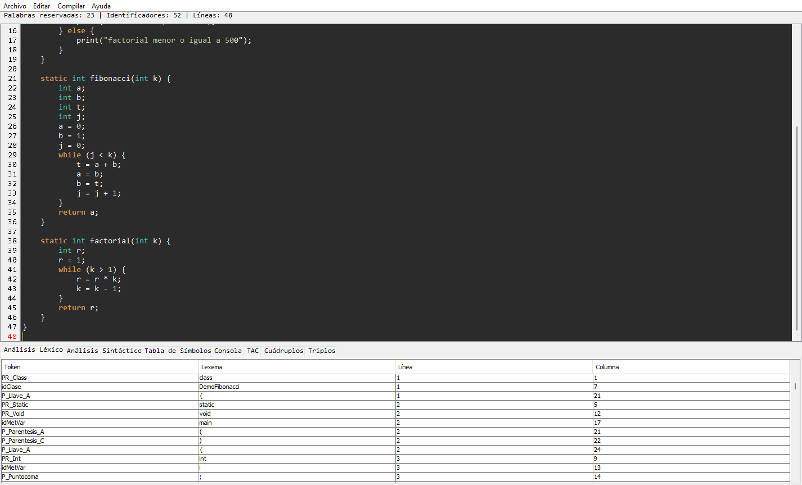
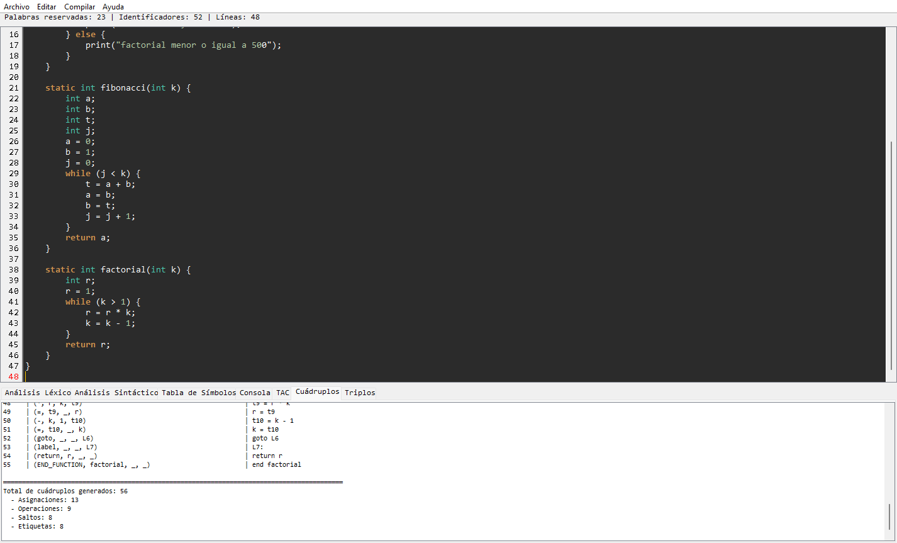

# Zyra Compiler

A full compiler, written in Java, for **Zyra**: an object-oriented language with Java-like syntax (classes, inheritance, static and instance methods, arrays, `instanceof` and casts). It goes from source code all the way to a native Windows executable, through **x86-64 NASM assembly**. It comes with a Swing IDE that shows tokens, the AST, the symbol table, intermediate code and the generated assembly.

  

## Pipeline

```text
Zyra source ─► Lexer (JFlex) ─► Parser (recursive descent ─► AST) ─► Semantic analysis (types, scopes, symbol table)
          ─► Intermediate code: three-address code, quadruples, triples
          ─► Optimizer: constant propagation · common-subexpression elimination · dead-code elimination · algebraic simplification
          ─► x86-64 NASM ─► nasm -f win64 ─► gcc link ─► .exe
```

| Phase | Where |
|---|---|
| Lexical analysis | `src/modulos/AnalizadorLexico.flex` (JFlex spec) |
| Syntax analysis | `src/modulos/AnalizadorSintactico.java` (hand-written recursive descent that builds the AST in `src/estructuras/ast`) |
| Semantic analysis | AST `chequear()` passes, symbol table in `src/estructuras/ts` |
| Intermediate code | `src/modulos/ir/GeneradorCodigoIntermedio.java`, `Cuadruplo`, `Triplo` |
| Optimization | `src/modulos/ir/optimizacion/` (4 passes orchestrated by `OptimizadorIR`) |
| Code generation | `src/modulos/ir/GeneradorEnsamblador.java`: one native function per method, args in `rcx/rdx/r8/r9`, return in `rax`, shadow space per the Windows x64 ABI, `printf`/`scanf`/`malloc` imports |
| Errors | typed lexical, syntax and semantic exceptions in `src/excepciones` |

About **9,000 lines of Java**, with **52 test programs** in [`test/`](test). They cover expressions, nested if/while, static and dynamic methods, inheritance, private members, `null`, `instanceof`, casts, unreachable code, arrays and matrices.

## Screenshots

| Program output (native .exe) | Three-address code |
|---|---|
|  |  |
| **Tokens** | **Quadruples** |
|  |  |

`test/DemoFibonacci.txt` compiles to a native executable that prints the first 10 Fibonacci numbers and `factorial(6) = 720`.

## Example

```java
class DemoSuma {
    static void main() {
        int x; int y;
        x = read();
        y = read();
        print(x + y);
    }
}
```

## Build & run

Requirements: JDK 17. To produce executables, also NASM and MinGW-w64 GCC on your `PATH`.

```powershell
javac -encoding UTF-8 -cp lib/* -d bin (Get-ChildItem -Recurse src -Filter *.java).FullName
java -cp "bin;lib/*" Vistas.Main
```

Open any file from `test/`, then compile it and run it from the IDE.

## Documentation

All documentation is in Spanish:
- [Technical documentation](docs/DOCUMENTACION_COMPILADOR_ZYRA.md)
- [Language grammar](docs/GramaticaZyra.pdf)
- [Quadruples & triples](docs/REPORTE_1_CUADRUPLOS_TRIPLOS.md)
- [Optimization](docs/REPORTE_2_OPTIMIZACION.md)
- [Assembly generation](docs/REPORTE_3_ENSAMBLADOR.md)
- [Object code guide](docs/GUIA_CODIGO_OBJETO.md)

## Credits

Designed and built by **Jovany Morales del Ángel** as the final project for *Lenguajes y Autómatas I*, Instituto Tecnológico Superior de Tantoyuca.
